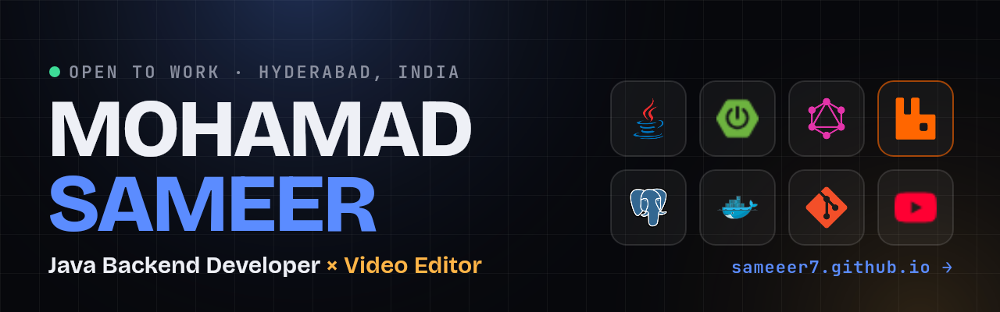

<p align="center">
  <a href="https://sameeer7.github.io"></a>
</p>

<h1 align="center">sameeer7.github.io</h1>

<p align="center">
  Personal portfolio of <b>Mohamad Sameer</b>, Java Backend Developer &amp; Video Editor.<br />
  <a href="https://sameeer7.github.io"><b>🔗 View it live</b></a>
</p>

<p align="center">
  
  
  
  
  
</p>

## ✨ Highlights

- **Engineer ⇄ Editor mode**: one click plays a full-screen wipe and recolours the whole site
- **Smooth scrolling** with Lenis, driven by GSAP ScrollTrigger
- **3D hover** on the portrait, with floating tech chips at different depths
- **Pinned horizontal scroll** through real client integrations, with animated data-flow diagrams (Shopify → RabbitMQ → CW Suite)
- **Edit Bay**: scrolling scrubs a video-editor timeline and playhead
- **Logo wall**: 20 tech logos fly in from all over the screen and assemble as you scroll
- **Video gallery**: episode and Shorts previews play on hover (on phones, as you scroll)
- Text effects with **SplitText** and **ScrambleText**, a scroll progress bar, a magnetic custom cursor
- Fully responsive, and respects *reduce motion* settings

## 🧱 Built with

| Layer | Tools |
|---|---|
| Markup & style | HTML5, CSS3 (custom properties, grid, `clip-path`, `color-mix`) |
| Animation | GSAP 3.13 · ScrollTrigger · SplitText · ScrambleText · CustomEase |
| Scrolling | Lenis |
| Hosting | GitHub Pages |

No build step and no framework: the libraries are stored in `vendor/`, so the site works without any CDN.

## 📁 Structure

```
index.html      page content
style.css       design, colours, layout
script.js       animations and interactions
assets/         photo, showreel, preview clips, thumbnails, resumes
assets/logos/   tech logos (SVG)
vendor/         GSAP plugins and Lenis
```

## ▶️ Run locally

Open `index.html` in a browser. That's it.

## ✏️ Quick edits

- **Text:** edit `index.html`
- **Colours:** change `--code` (blue) and `--cut` (amber) at the top of `style.css`
- **Extra YouTube embeds:** add `{ id: "VIDEO_ID", type: "short" }` to the `VIDEOS` list at the top of `script.js`
- **Showreel:** replace `assets/showreel.mp4` (keep the same file name)

## 📫 Contact

**Mohamad Sameer**: [sameer.mohamad.m@gmail.com](mailto:sameer.mohamad.m@gmail.com) · [LinkedIn](https://www.linkedin.com/in/sameer-mohamad-0053711b9) · [YouTube](https://youtube.com/@beginwithsam)
